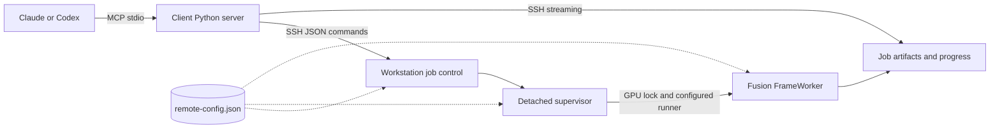

# Design

The client process implements MCP using the official Python SDK and stdio. Every control operation starts a short SSH command on the workstation. A render request creates a durable job directory and detaches a supervisor, allowing either client to reconnect and query or cancel it later.

The supervisor runs with system Python. The adapter runs through the configured runner in Fusion's environment, with `CUDA_DEVICE_ORDER=PCI_BUS_ID`, `CUDA_VISIBLE_DEVICES` set to the configured GPU index, offscreen Qt and two CPU threads. A separate process per job releases model memory on completion and contains native-library failures.

## Configuration flow

Client settings say where to connect. `VISOMASTER_HOST`, `VISOMASTER_REMOTE` and the optional interpreter, SSH program and download directory come from the client registration. `transport.py` validates them on the first tool call, builds the SSH argv with `--` before the host, and quotes the remote command with `shlex.join`; `deploy.sh` runs the same validation before any SSH call.

Workstation settings say where things are. They live in one file, `remote-config.json` in the deployment root, and nothing is forwarded over SSH. Control commands, supervisors and workers each locate the file relative to their own resolved code path (two levels above a release directory), so every client and reconnect sees the same values. Import never fails: a missing or invalid file is reported by `health` and refuses every other action.

Each job stores the SHA-256 of the effective, resolved configuration. `submit` starts the supervisor with the absolute job directory and that identity, so the supervisor never looks the job up through configuration that may have changed. After taking the job's lease, the supervisor reloads the configuration and fails the job, in its original directory, if the file is invalid, the identity differs or the state directory moved. It repeats the check while waiting for the GPU lock and once more before starting the worker. The worker receives `VM_CONFIG` and `VM_CONFIG_SHA256` and checks the identity again before importing Fusion. The release symlink pins code, and this identity pins configuration.

The runner must `exec` Fusion's interpreter: the worker checks that its parent is the supervisor, and reports a runner that forks instead with an actionable error.

The adapter builds a small state object with Fusion's expected controls, parameters and face references. It reads literal default settings from the installed layout definitions, then calls Fusion's `ModelsProcessor`, `FunctionWorker` and `FrameWorker`. It validates the commit and tracked `app` changes before importing the pipeline. GPU calls use the CUDA provider. User-adjustable settings are explicitly allowlisted and checked against the installed choices and numeric limits.

Reference matching uses Fusion's recognition embeddings and similarity thresholds. Multiple source images are averaged per identity. Multiple target mappings are supported by the same pipeline. By default the adapter detects and matches each video frame independently. A render that enables Fusion's `FaceTrackingEnableToggle` (ByteTrack) or `KPSSmoothingEnableToggle` (landmark EMA) instead uses Fusion's playback path: one `SequentialDetector` sees the frames in order, keeps ByteTrack, smoothing and identity state between them, and feeds its detections to a non-single-frame `FrameWorker`. Previews and detection stay single-frame. At the pinned revision this path is opt-in because qualification showed no default benefit: with both toggles off it decoded to frames identical to the per-frame path, ByteTrack alone changed no output on the qualified clips, smoothing lowered face-region frame-to-frame residual change by about 3%, and the path rendered 16–25% slower because Fusion recognizes each face twice. Fusion's temporal identity rescue does not reach the output: the worker's threshold bypass only applies to plain dictionaries, and Fusion passes `ParametersDict` objects in its own playback too. Tracking does not suppress intermittent swaps of a non-target face that sometimes clears the similarity threshold. Raising `SimilarityThresholdSlider` from 60 to 75 removed that on the qualified two-person clip.

The first release covers conventional flat images and constant-frame-rate videos, embedding-based swap models, selected mask controls, face restoration and expression restoration. GUI workspace import, DFM, AlphaFace, VR180, timeline markers and manual face editing require additional adapters and qualification.

Video rendering checks packet presentation timestamps over the requested range, decodes frames at exact indices through an FFmpeg pipe and writes H.264 through FFmpeg. It rejects variable frame rate and nonzero video start timestamps, as well as odd frame dimensions. Output retains the input frame rate and dimensions. Decoding to BGR and encoding back use the source's YUV matrix and range with accurate swscale rounding, and the output carries the source's color tags, so unswapped pixels keep their color. Sources above 8 bits are encoded as 10-bit H.264, although Fusion itself processes 8-bit BGR. HDR (PQ or HLG) input is rejected rather than tone-mapped, since the face models would see 8-bit nonlinear HDR values. The first audio stream is trimmed to the requested interval and encoded as AAC. Every output is checked for video frame count, duration and expected audio presence. A render with zero successful face swaps fails. Fusion's caught per-face errors also fail the job when reported on stdout. A worker exception's message becomes the job error, while its traceback stays in worker.log.

Normalization jobs convert such inputs with FFmpeg alone. The worker never imports Fusion, and the supervisor neither waits for nor holds the GPU lock, so normalization runs alongside a GPU job and alongside other normalizations. FFmpeg autorotates and the output carries no rotation or container metadata. Video timestamps are rebased to zero and resampled to a constant rate: the requested `fps`, or the source average rate snapped to a standard rate within 2%. Odd dimensions are padded by one pixel on the right or bottom rather than cropped, so no face pixels are lost. Video is encoded as H.264 at CRF 18, in 10-bit for sources above 8 bits, and keeps the source's color range and tags; HDR input is rejected as for renders. The first audio stream becomes AAC, trimmed or padded with silence to stay aligned with the first video frame and trimmed at the video's end. The output passes the render timestamp check and its frame count, duration and audio presence are validated before `normalized.mp4` is published. Its job artifact path lies inside the configured media root, so it is directly usable as a render input.

State and progress JSON files use atomic replacement. Submission has a shared lock, and a stable job ID makes identical retries idempotent. A per-GPU lock (`gpu-<index>.lock` in the configured lock directory) serializes workers across clients and across deployments that share that directory. The supervisor first starts a small guard process that leads a new process group, then starts the worker in that group. It reaps the guard last, so the group ID stays reserved and its signals cannot reach another group. Cancellation checks the job and writes its marker under the submit lock, so a delayed request cannot mark a replacement job that reused the ID. The supervisor sends SIGTERM to the group and gives the worker 10 seconds to exit. However the worker exits, the supervisor then kills the remaining group members and waits for them before it publishes a terminal state. A cancellation that arrives after the worker has succeeded leaves the job completed. If the supervisor dies, the guard sees its pipe close and kills the group, and Linux parent-death handling also stops the worker. A worker inherits the GPU lock until it exits. On status access, a job whose supervisor lease vanished becomes failed after a startup grace period. Terminal states record `finished_at`. Older terminal records without it report their state file's modification time, which status, listing and pruning share.

Media paths resolve within the configured media root, and artifact paths resolve inside their job directory. Every FFmpeg and FFprobe input, including timing probes, normalization and the render's audio input, is opened with only the `file` protocol and a demuxer allowlist of self-contained formats (MP4/MOV, Matroska/WebM, AVI, MPEG-TS and single PNG, JPEG, WebP or BMP images). Libavformat refuses any other detected format before reading its header, so an HLS playlist or concat list, whatever its extension, cannot open files the path check never saw; the probe reports it as an unsupported container. FFprobe reads JPEGs detected as `image2` with pattern expansion off, and the FFmpeg CLI never uses `image2`, so `%d` names do not expand into other files. SSH provides the transport and authentication. MCP adds no listening TCP endpoint. Uploads are named by the SHA-256 the client computes before sending; an existing file with that name and size is returned without a transfer. New files publish only after a complete transfer whose size and hash the workstation verifies. Older random 32-hex names remain accepted. Video transfers stream to disk, while inline PNG/JPEG responses have a 10 MB limit.

Retention decisions share the submit lock. Submission validates inputs under it and stores `resolved.json` beside the unchanged `request.json`: the request with every media, target and source path resolved. The worker opens those resolved paths, so redirecting an alias later changes neither what a job reads nor what cleanup protects. Deletion and pruning, including its dry run, apply one eligibility check under the lock: the job's supervisor lease must be free, its state terminal, its finish time older than the cutoff for pruning, and no queued or running job's resolved input may lie inside it. The check reads the generation it then renames to a trash name, and the trash is removed outside the lock. An upload file or directory is kept when a resolved input is that path or lies beneath it, compared by path component. While any active job lacks `resolved.json` (submitted by an earlier release), its inputs are unknown and no job or upload is removed. Upload reuse refreshes the file's timestamp and upload publication renames the completed file under the same lock, so a prune either sees the refresh or the new file, or removes the old file first and the reuse becomes a cache miss. Streaming stays outside the lock.

The shared GPU lock guarantees mutual exclusion but does not guarantee FIFO scheduling. Uploads and artifact downloads are foreground MCP calls, so very large transfers depend on the client's timeout configuration. Long rendering work is always submitted as a background job.
