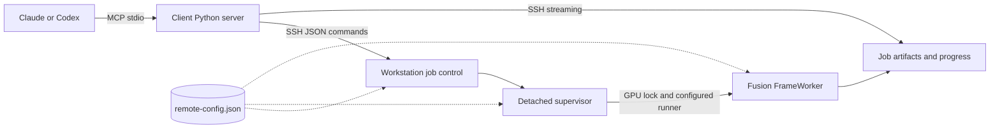

# Design

The client process implements MCP using the official Python SDK and stdio. Every control operation starts a short SSH command on the workstation. A render request creates a durable job directory and detaches a supervisor, allowing either client to reconnect and query or cancel it later.

The supervisor runs with system Python. The adapter runs through the configured runner in Fusion's environment, with `CUDA_DEVICE_ORDER=PCI_BUS_ID`, `CUDA_VISIBLE_DEVICES` set to the configured GPU index, offscreen Qt and two CPU threads. A separate process per job releases model memory on completion and contains native-library failures.

## Configuration flow

Client settings say where to connect. `VISOMASTER_HOST`, `VISOMASTER_REMOTE` and the optional interpreter, SSH program and download directory come from the client registration. `transport.py` validates them on the first tool call, builds the SSH argv with `--` before the host, and quotes the remote command with `shlex.join`; `deploy.sh` runs the same validation before any SSH call.

Workstation settings say where things are. They live in one file, `remote-config.json` in the deployment root, and nothing is forwarded over SSH. Control commands, supervisors and workers each locate the file relative to their own resolved code path (two levels above a release directory), so every client and reconnect sees the same values. Import never fails: a missing or invalid file is reported by `health` and refuses every other action.

Each job stores the SHA-256 of the effective, resolved configuration. `submit` starts the supervisor with the absolute job directory and that identity, so the supervisor never looks the job up through configuration that may have changed. After taking the job's lease, the supervisor reloads the configuration and fails the job, in its original directory, if the file is invalid, the identity differs or the state directory moved. It repeats the check while waiting for the GPU lock and once more before starting the worker. The worker receives `VM_CONFIG` and `VM_CONFIG_SHA256` and checks the identity again before importing Fusion. The release pins code, and this identity pins configuration.

A control command started through the `remote` symlink re-executes from the release directory the link resolves to before loading any project module, so the command, its supervisor and its engine all come from one immutable release. Submission rechecks the selected release after taking the submit lock; if a deployment switched it meanwhile, the command reruns from the new release with the same request. Each job records its release. `deploy.sh` uploads a candidate under a unique name and preflights it, then runs the candidate's `promote` action, which takes the submit lock, refuses while jobs are queued or running unless forced, replaces the link through a uniquely named staging link, verifies that the link selects the candidate and removes all but the five newest releases. It never removes the selected release or one an active job records, and removes none while an active job lacks the record. A deployment either sees a job or the job runs the release it selected, and concurrent deployments cannot promote each other's candidate. A legacy flat `remote` directory is moved into `releases/` before the first switch.

The runner must `exec` Fusion's interpreter: the worker checks that its parent is the supervisor, and reports a runner that forks instead with an actionable error.

The adapter builds a small state object with Fusion's expected controls, parameters and face references. It reads literal default settings from the installed layout definitions, then calls Fusion's `ModelsProcessor`, `FunctionWorker` and `FrameWorker`. It validates the commit and tracked `app` changes (staged or not) before importing the pipeline, using the same standard-library check whose result and reason `health_check` reports. GPU calls use the CUDA provider. User-adjustable settings are explicitly allowlisted and checked against the installed choices and numeric limits.

Reference matching uses Fusion's recognition embeddings and similarity thresholds. Multiple source images are averaged per identity. Multiple target mappings are supported by the same pipeline. By default the adapter detects and matches each video frame independently. A render that enables Fusion's `FaceTrackingEnableToggle` (ByteTrack) or `KPSSmoothingEnableToggle` (landmark EMA) instead uses Fusion's playback path: one `SequentialDetector` sees the frames in order, keeps ByteTrack, smoothing and identity state between them, and feeds its detections to a non-single-frame `FrameWorker`. Previews and detection stay single-frame. At the pinned revision this path is opt-in because qualification showed no default benefit: with both toggles off it decoded to frames identical to the per-frame path, ByteTrack alone changed no output on the qualified clips, smoothing lowered face-region frame-to-frame residual change by about 3%, and the path rendered 16–25% slower because Fusion recognizes each face twice. Fusion's temporal identity rescue does not reach the output: the worker's threshold bypass only applies to plain dictionaries, and Fusion passes `ParametersDict` objects in its own playback too. Tracking does not suppress intermittent swaps of a non-target face that sometimes clears the similarity threshold. Fusion's `SwapOnlyBestMatchEnableToggle` does: for each target it swaps only the highest-scoring face among those whose best match is that target and that clear its threshold. The adapter turns it on by default (callers may turn it off) because on the qualified two-person clip it removed every non-target swap at the default threshold of 60 while keeping the target on every frame, as raising the threshold to 75 did, without raising the score the target itself must reach. It cannot stop a look-alike from being swapped in frames where the target is absent, and with it on a target seen twice in one frame is swapped once.

Detection crops pad each face's box by 30% of its longer side. A crop is a usable `target_face` only if it is verified as the reference `submit_swap` will read: re-detected with the same detector limit `configure_faces` uses, it must contain exactly one face, whose box overlaps the original by an IoU of at least 0.5 and whose recognition embedding scores at least the default `SimilarityThresholdSlider` against the original detection's. A neighbour inside the padding fails the count and a lone neighbour fails the overlap and score, so a crop padded by 10% is tried next; multi-frame detection tries up to five of an identity's largest faces in turn. An unverified crop is still published for inspection, but its `reference_path` is null, it is framed in red and marked `*` on the contact sheet, and a result with no verified crop carries a warning. The score check also rejects crops whose own face would not match itself at swap time: qualification found strong profile views re-recognizing at 47–50 against their full-frame embedding, while frontal and three-quarter faces scored 62–99.

The first release covers conventional flat images and constant-frame-rate videos, embedding-based swap models, selected mask controls, face restoration and expression restoration. GUI workspace import, DFM, AlphaFace, VR180, timeline markers and manual face editing require additional adapters and qualification.

Video rendering checks packet presentation timestamps over the requested range, decodes frames at exact indices through an FFmpeg pipe and writes H.264 through FFmpeg. Decoding and the source-audio trim seek on the video stream's own timestamps (`-seek_timestamp`), so a container that starts earlier, for example with leading audio, shifts neither the frames nor the audio interval. It rejects variable frame rate and nonzero video start timestamps, odd frame dimensions and any display matrix that rotates or mirrors the picture, since frames are decoded as stored. A flip can report rotation 0, so the matrix itself is checked. Output retains the input frame rate, dimensions and sample aspect ratio, which the raw frame pipe loses and the encoder sets again and output validation checks. Decoding to BGR and encoding back use the source's YUV matrix and range with accurate swscale rounding, and the output carries the source's color tags, so unswapped pixels keep their color. RGB sources (FFprobe's `gbr` matrix, which a YUV output cannot carry) are encoded as BT.709 limited range and tagged so. Gray sources without a range tag are full range, as swscale treats them. swscale treats gray as full range whatever its tag, so limited-range gray is first copied code for code into YUV 4:4:4 of the same depth and then tagged limited. Only the matrices swscale implements are accepted: BT.709, BT.601 (`smpte170m`, `bt470bg`), FCC, SMPTE 240M, BT.2020 non-constant luminance, and untagged video, which swscale decodes as BT.601. Other matrices, such as YCgCo, BT.2020 constant luminance, ICtCp, SMPTE 2085 and the chromaticity-derived ones, are refused by renders, detection and normalization alike before anything is written, with advice to transcode the source to BT.709 elsewhere: FFmpeg 8 cannot convert them, and 6.1 would silently apply other coefficients. Primaries and transfer are set on the frames, since FFmpeg 8 ignores encoder options for them; the audio mux copies the video stream, so they and the sample aspect ratio reach the result. Sources above 8 bits are encoded as 10-bit H.264, although Fusion itself processes 8-bit BGR. Depth comes from the stream's raw sample depth, or when FFprobe reports none, the deepest component of the decoded pixel format's FFmpeg descriptor, so gray, packed RGB and semiplanar formats count as well as planar YUV. HDR (PQ or HLG) input is rejected rather than tone-mapped, since the face models would see 8-bit nonlinear HDR values. Audio comes from the first audio stream alone. When it has samples in the rendered interval, as one decoded frame through the mux's own input window shows, that interval is encoded as AAC, padded with silence where the stream starts later so it keeps its timing. When it has none, because it ends before the interval or starts after it, the output has no audio and the result reports `audio: none`. Every output is checked for video frame count and duration, for the audio that overlap requires, and for audio ending no more than one AAC frame after the video; the result's `audio` describes the written file. A render with zero successful face swaps fails. Fusion's caught per-face errors also fail the job when reported on stdout. A worker exception's message becomes the job error, while its traceback stays in worker.log.

Detection and previews select a zero-based frame by decoded order. The video stream's packet timestamps, read without decoding, give that frame's presentation time, so variable-frame-rate input yields the exact frame rather than one estimated from the average rate. An index at or beyond the frame count is rejected as out of range, and still images have only frame 0. Sampling counts the video stream's own frames, since container duration can describe a longer audio track or be missing. Frames after the first of a video whose packets lack timestamps (as in some AVI files) require normalization.

Normalization jobs convert such inputs with FFmpeg alone. The worker never imports Fusion, submission and worker validation never read its layout files, and a normalization request may carry only `media_path` and `fps` (GPU fields are refused rather than ignored), and the supervisor neither waits for nor holds the GPU lock, so normalization runs alongside a GPU job and alongside other normalizations. FFmpeg applies the display matrix, rotations and flips alike, and the output carries no display matrix or container metadata. The result's `rotation_applied` is FFprobe's rotation angle and `reflection_applied` reports a mirrored matrix. Video timestamps are rebased to zero and resampled to a constant rate: the requested `fps`, or the source average rate snapped to a standard rate within 2%. The output has the source duration times the rate, rounded to the nearest frame as FFmpeg's `fps` filter does, but at least one frame, so a clip shorter than half a target frame period keeps its first frame for one period. Odd dimensions are padded by one pixel on the right or bottom rather than cropped, so no face pixels are lost. Video is encoded as H.264 at CRF 18, with the render's depth and color policy, through an explicit swscale conversion so that FFmpeg versions do not negotiate a different matrix or range, and keeps the sample aspect ratio; HDR input is rejected as for renders. The video is encoded first. The first audio stream is then added as AAC over exactly the encoded video's interval, which resampling can make shorter or longer than the source video and which needs no source duration tag: earlier audio is trimmed and later audio padded with silence to stay aligned with the first video frame, and audio ends with the video or, if shorter, before it without shortening the video. As for renders, a stream without samples in that interval yields no audio. The output passes the render timestamp check, and its frame count, duration, required audio and audio end (within one AAC frame of the video's) are validated before `normalized.mp4` is published. The result's `audio`, `audio_start_time` and `audio_duration` describe the published track. The expected frame count comes from the video stream's own duration, or a scan of its packet timestamps when that is missing, never from the container duration; output much shorter than that fails. It is only an estimate: progress reports it as `estimated_total_frames`, with `eta_seconds`, both null when the extent is unknown, and the result's `frames` is the validated count. Detection and render progress report exact `total_frames`. Its job artifact path is accepted as an input wherever the state directory lies, so it is directly usable as a render input.

State and progress JSON files use atomic replacement. Submission has a shared lock, and a stable job ID makes identical retries idempotent. Under that lock an existing ID is answered from its persisted request, compared as canonical JSON, before any input or Fusion file is consulted, so an exact retry returns the job after its inputs are gone and a changed payload is a conflict; only a new job is validated and published. A per-GPU lock (`gpu-<index>.lock` in the configured lock directory) serializes workers across clients and across deployments that share that directory. The supervisor first starts a small guard process that leads a new process group, then starts the worker in that group. It reaps the guard last, so the group ID stays reserved and its signals cannot reach another group. Cancellation checks the job and writes its marker under the submit lock, so a delayed request cannot mark a replacement job that reused the ID. The supervisor sends SIGTERM to the group and gives the worker 10 seconds to exit. However the worker exits, the supervisor then kills the remaining group members and waits for them before it publishes a terminal state. A cancellation that arrives after the worker has succeeded leaves the job completed. If the supervisor dies, the guard sees its pipe close and kills the group, and Linux parent-death handling also stops the worker. A worker inherits the GPU lock until it exits. On status access, a job whose supervisor lease vanished becomes failed after a startup grace period. Terminal states record `finished_at`. Older terminal records without it report their state file's modification time, which status, listing and pruning share.

Media paths are resolved, then must lie within the configured media root or be a managed state file: a complete upload in `uploads/` or a file under a job's `artifacts/`. The rest of the state tree (requests, logs, locks, staging, trash, partial uploads) is never an input, whether or not it lies inside the media root, and resolution means symlinks and `..` are judged by their targets. Artifact paths resolve inside their job directory. Every FFmpeg and FFprobe input, including timing probes, normalization and the render's audio input, is opened with only the `file` protocol and a demuxer allowlist of self-contained formats (MP4/MOV, Matroska/WebM, AVI, MPEG-TS and single PNG, JPEG, WebP or BMP images). Libavformat refuses any other detected format before reading its header, so an HLS playlist or concat list, whatever its extension, cannot open files the path check never saw; the probe reports it as an unsupported container. FFprobe reads JPEGs detected as `image2` with pattern expansion off, and the FFmpeg CLI never uses `image2`, so `%d` names do not expand into other files. SSH provides the transport and authentication. MCP adds no listening TCP endpoint. Uploads are named by the SHA-256 the client computes before sending; an existing file with that name and size is returned without a transfer. New files publish only after a complete transfer whose size and hash the workstation verifies. Older random 32-hex names remain accepted. Artifact transfers run one workstation command that opens the completed job's directory and artifact without following symlinks, then sends a size header and exactly those bytes from the same descriptor, so a job deleted and replaced under the same ID mid-transfer cannot substitute its content. Video transfers stream to disk, while inline PNG/JPEG responses have a 10 MB limit that the workstation checks before sending and the client enforces while reading. A download streams into a temporary file in the downloads root and is renamed into the job's subdirectory, which is reopened without following symlinks, so a symlinked or swapped job directory cannot redirect the write outside the root.

Retention decisions share the submit lock. Submission validates inputs under it and stores `resolved.json` beside the unchanged `request.json`: the request with every media, target and source path resolved. The worker opens those resolved paths, so redirecting an alias later changes neither what a job reads nor what cleanup protects. Deletion and pruning, including its dry run, apply one eligibility check under the lock: the job's supervisor lease must be free, its state terminal, its finish time older than the cutoff for pruning, and no queued or running job's resolved input may lie inside it. The check reads the generation it then renames to a trash name, and the trash is removed outside the lock. An upload file or directory is kept when a resolved input is that path or lies beneath it, compared by path component. While any active job lacks `resolved.json` (submitted by an earlier release), its inputs are unknown and no job or upload is removed. Upload reuse refreshes the file's timestamp and upload publication renames the completed file under the same lock, so a prune either sees the refresh or the new file, or removes the old file first and the reuse becomes a cache miss. Streaming stays outside the lock.

The shared GPU lock guarantees mutual exclusion but does not guarantee FIFO scheduling. Uploads and artifact downloads are foreground MCP calls, so very large transfers depend on the client's timeout configuration. Long rendering work is always submitted as a background job.
