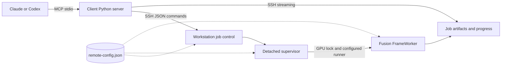

# Design

The client process implements MCP using the official Python SDK and stdio. Every control operation starts a short SSH command on the workstation. A render request creates a durable job directory and detaches a supervisor, allowing either client to reconnect and query or cancel it later.

The supervisor runs with system Python. The adapter runs through the configured runner in Fusion's environment, with `CUDA_DEVICE_ORDER=PCI_BUS_ID`, `CUDA_VISIBLE_DEVICES` set to the configured GPU index, offscreen Qt and two CPU threads. A separate process per job releases model memory on completion and contains native-library failures.

## Configuration flow

Client settings say where to connect. `VISOMASTER_HOST`, `VISOMASTER_REMOTE` and the optional interpreter, SSH program and download directory come from the client registration. `transport.py` validates them on the first tool call, builds the SSH argv with `--` before the host, and quotes the remote command with `shlex.join`; `deploy.sh` runs the same validation before any SSH call.

Workstation settings say where things are. They live in one file, `remote-config.json` in the deployment root, and nothing is forwarded over SSH. Control commands, supervisors and workers each locate the file relative to their own resolved code path (two levels above a release directory), so every client and reconnect sees the same values. Import never fails: a missing or invalid file is reported by `health` and refuses every other action.

Each job stores the SHA-256 of the effective, resolved configuration. `submit` starts the supervisor with the absolute job directory and that identity, so the supervisor never looks the job up through configuration that may have changed. After taking the job's lease, the supervisor reloads the configuration and fails the job, in its original directory, if the file is invalid, the identity differs or the state directory moved. It repeats the check while waiting for the GPU lock and once more before starting the worker. The worker receives `VM_CONFIG` and `VM_CONFIG_SHA256` and checks the identity again before importing Fusion. The release pins code, and this identity pins configuration.

A control command started through the `remote` symlink re-executes from the release directory the link resolves to before loading any project module, so the command, its supervisor and its engine all come from one immutable release. Submission rechecks the selected release after taking the submit lock; if a deployment switched it meanwhile, the command reruns from the new release with the same request. Each job records its release. `deploy.sh` uploads a candidate under a unique name and preflights it, then runs the candidate's `promote` action, which takes the submit lock, refuses while jobs are queued or running unless forced, replaces the link through a uniquely named staging link, verifies that the link selects the candidate and removes all but the five newest releases. It never removes the selected release or one an active job records, and removes none while an active job lacks the record. A deployment either sees a job or the job runs the release it selected, and concurrent deployments cannot promote each other's candidate. A legacy flat `remote` directory is moved into `releases/` before the first switch.

The runner must `exec` Fusion's interpreter: the worker checks that its parent is the supervisor, and reports a runner that forks instead with an actionable error.

The adapter builds a small state object with Fusion's expected controls, parameters and face references. It reads literal default settings from the installed layout definitions, then calls Fusion's `ModelsProcessor`, `FunctionWorker` and `FrameWorker`. It validates the commit and tracked `app` changes (staged or not) before importing the pipeline, using the same standard-library check whose result and reason `health_check` reports. GPU calls use the CUDA provider. User-adjustable settings are explicitly allowlisted and checked against the installed choices and numeric limits.

Reference matching uses Fusion's recognition embeddings and similarity thresholds. Multiple source images are averaged per identity, then L2-normalized as Fusion's own merge does, optionally with explicit weights (see below). Multiple target mappings are supported by the same pipeline. By default the adapter detects and matches each video frame independently. A render that enables Fusion's `FaceTrackingEnableToggle` (ByteTrack) or `KPSSmoothingEnableToggle` (landmark EMA) instead uses Fusion's playback path: one `SequentialDetector` sees the frames in order, keeps ByteTrack, smoothing and identity state between them, and feeds its detections to a non-single-frame `FrameWorker`. Previews and detection stay single-frame. At the pinned revision this path is opt-in because qualification showed no default benefit: with both toggles off it decoded to frames identical to the per-frame path, ByteTrack alone changed no output on the qualified clips, smoothing lowered face-region frame-to-frame residual change by about 3%, and the path rendered 16–25% slower because Fusion recognizes each face twice. Fusion's temporal identity rescue does not reach the output: the worker's threshold bypass only applies to plain dictionaries, and Fusion passes `ParametersDict` objects in its own playback too. Tracking does not suppress intermittent swaps of a non-target face that sometimes clears the similarity threshold. Fusion's `SwapOnlyBestMatchEnableToggle` does: for each target it swaps only the highest-scoring face among those whose best match is that target and that clear its threshold. The adapter turns it on by default (callers may turn it off) because on the qualified two-person clip it removed every non-target swap at the default threshold of 60 while keeping the target on every frame, as raising the threshold to 75 did, without raising the score the target itself must reach. It cannot stop a look-alike from being swapped in frames where the target is absent, and with it on a target seen twice in one frame is swapped once.

Detection crops pad each face's box by 30% of its longer side. A crop is a usable `target_face` only if it is verified as the reference `submit_swap` will read: re-detected with the same detector limit `configure_faces` uses, it must contain exactly one face, whose box overlaps the original by an IoU of at least 0.5 and whose recognition embedding scores at least the default `SimilarityThresholdSlider` against the original detection's. A neighbour inside the padding fails the count and a lone neighbour fails the overlap and score, so a crop padded by 10% is tried next; multi-frame detection tries up to five of an identity's largest faces in turn. An unverified crop is still published for inspection, but its `reference_path` is null, it is framed in red and marked `*` on the contact sheet, and a result with no verified crop carries a warning. The score check also rejects crops whose own face would not match itself at swap time: qualification found strong profile views re-recognizing at 47–50 against their full-frame embedding, while frontal and three-quarter faces scored 62–99.

Source weights follow Fusion's merge in `calculate_assigned_input_embedding` (`EmbMergeMethodSelection` "Mean", then L2 normalization), which earlier releases applied without the normalization. Inswapper-family, InStyleSwapper and SimSwap latents normalize their input, so their swaps are unchanged; GhostFace and CSCS take the embedding as given and now receive the unit vector Fusion's GUI gives them. With explicit weights the mean is weighted; only ratios matter, and a weight of 0 excludes an image without reading it. Submission validates weights (finite, nonnegative, one per source, positive and finite sum) and records the request unchanged, so omitted weights keep the earlier request form and its idempotent retries. Every reference read by a job is fingerprinted: submission stores the SHA-256 of each target, source and analyzed image in `resolved.json` (or checks a caller's `source_sha256` first), worker validation compares them again, and the engine hashes the bytes it decodes with `cv2.imdecode`, which applies EXIF orientation as `imread` does. A file edited after submission therefore fails the job rather than being used, and preview and render results list the fingerprints, weights and shares each mapping used. Reference files are limited to 256 MiB, so a misplaced video cannot hold the submit lock while it is hashed.

Reference analysis is a queued GPU job kind, `analyze`, with its own request keys (`references`, `swap_model`, `thresholds`, `controls`); it has no `media_path`, and other keys are refused. It shares the GPU lock, retention protection (its references count as inputs) and validation path with other jobs, and needs no stage of its own beyond Fusion's detector and recognizer. Each image is decoded from its fingerprinted bytes and detected with `detect_reference`, exactly as `configure_faces` reads it, then embedded with the ArcFace model of the requested swap model, the embedding the swap merge averages. Sharpness is the Laplacian variance of the face box's luma at the 112-pixel ArcFace input scale, so it combines blur and small size; it is computed in plain Python on that 112 × 112 grid. Collection checks run on the usable references only: byte-identical files are exact duplicates, embedding similarity at or above `duplicate_similarity` marks near duplicates, and a leave-one-out score against the normalized mean of the others marks outliers. With fewer than three distinct usable references no outlier is named, since a disagreement between two cannot be attributed. Findings report and never alter the collection, and analysis results are not consumed by swaps: a swap recomputes embeddings from its own fingerprinted bytes, so changed images or a different swap model cannot reuse stale analysis.

The first release covers conventional flat images and constant-frame-rate videos, embedding-based swap models, selected mask controls, face restoration and expression restoration. GUI workspace import, DFM, AlphaFace, VR180, timeline markers and manual face editing require additional adapters and qualification.

Video rendering checks packet presentation timestamps over the requested range, decodes frames at exact indices through an FFmpeg pipe and writes H.264 through FFmpeg. Decoding and the source-audio trim seek on the video stream's own timestamps (`-seek_timestamp`), so a container that starts earlier, for example with leading audio, shifts neither the frames nor the audio interval. It rejects variable frame rate and nonzero video start timestamps, odd frame dimensions and any display matrix that rotates or mirrors the picture, since frames are decoded as stored. A flip can report rotation 0, so the matrix itself is checked. Output retains the input frame rate, dimensions and sample aspect ratio, which the raw frame pipe loses and the encoder sets again and output validation checks. Decoding to BGR and encoding back use the source's YUV matrix and range with accurate swscale rounding, and the output carries the source's color tags, so unswapped pixels keep their color. RGB sources (FFprobe's `gbr` matrix, which a YUV output cannot carry) are encoded as BT.709 limited range and tagged so. Gray sources without a range tag are full range, as swscale treats them. swscale treats gray as full range whatever its tag, so limited-range gray is first copied code for code into YUV 4:4:4 of the same depth and then tagged limited. Only the matrices swscale implements are accepted: BT.709, BT.601 (`smpte170m`, `bt470bg`), FCC, SMPTE 240M, BT.2020 non-constant luminance, and untagged video, which swscale decodes as BT.601. Other matrices, such as YCgCo, BT.2020 constant luminance, ICtCp, SMPTE 2085 and the chromaticity-derived ones, are refused by renders, detection and normalization alike before anything is written, with advice to transcode the source to BT.709 elsewhere: FFmpeg 8 cannot convert them, and 6.1 would silently apply other coefficients. Primaries and transfer are set on the frames, since FFmpeg 8 ignores encoder options for them; the audio mux copies the video stream, so they and the sample aspect ratio reach the result. Sources above 8 bits are encoded as 10-bit H.264, although Fusion itself processes 8-bit BGR. Depth comes from the stream's raw sample depth, or when FFprobe reports none, the deepest component of the decoded pixel format's FFmpeg descriptor, so gray, packed RGB and semiplanar formats count as well as planar YUV. HDR (PQ or HLG) input is rejected rather than tone-mapped, since the face models would see 8-bit nonlinear HDR values. Audio comes from the first audio stream alone. When it has samples in the rendered interval, as one decoded frame through the mux's own input window shows, that interval is encoded as AAC, padded with silence where the stream starts later so it keeps its timing. When it has none, because it ends before the interval or starts after it, the output has no audio and the result reports `audio: none`. Every output is checked for video frame count and duration, for the audio that overlap requires, and for audio ending no more than one AAC frame after the video; the result's `audio` describes the written file. A render with zero successful face swaps fails. Fusion's caught per-face errors also fail the job when reported on stdout. A worker exception's message becomes the job error, while its traceback stays in worker.log.

Swap reports instrument Fusion's matching instead of repeating it. The adapter's `FrameWorker` subclass wraps `_find_best_target_match`, which both of Fusion's swap loops call once per target for each face. For each face embedding seen in the frame, the wrapper records Fusion's chosen target and computes the face's similarity to every mapping's target embedding once, using Fusion's own `findCosineDistance`. It wraps `swap_core` and attributes each swap to the mapping whose target embedding array Fusion passes as `t_e`, or records a raised error against it. It also counts each frame's detections by wrapping the window's `FunctionWorker.run_detect`, which the per-frame path and the `SequentialDetector` both call. No model runs again. Faces that never reach matching are counted as unscored, and their scores are unknown. In the per-frame path these are faces below Fusion's minimum size or with invalid landmarks. In the sequential path they are the faces its identity filter dropped. Recorded outcomes go into per-mapping counters and online run-length intervals: one record per mapping and reason, a bounded interval list and O(1) state per open run, so long renders keep telemetry bounded. A `not_requested` state is excluded from every denominator and ends a dropout without flagging it, for future per-segment mappings. The report is written only after the output passes validation, before `result.json`. A failed or cancelled job therefore never exposes it, and its artifacts are withheld anyway. Review images decode the source and `result.mp4` at the same frame index, with the CFR seek renders already rely on, so each pair shows the actual published output.

Detection and previews select a zero-based frame by decoded order. The video stream's packet timestamps, read without decoding, give that frame's presentation time, so variable-frame-rate input yields the exact frame rather than one estimated from the average rate. An index at or beyond the frame count is rejected as out of range, and still images have only frame 0. Sampling counts the video stream's own frames, since container duration can describe a longer audio track or be missing. Frames after the first of a video whose packets lack timestamps (as in some AVI files) require normalization.

Normalization jobs convert such inputs with FFmpeg alone. The worker never imports Fusion, submission and worker validation never read its layout files, and a normalization request may carry only `media_path` and `fps` (GPU fields are refused rather than ignored), and the supervisor neither waits for nor holds the GPU lock, so normalization runs alongside a GPU job and alongside other normalizations. FFmpeg applies the display matrix, rotations and flips alike, and the output carries no display matrix or container metadata. The result's `rotation_applied` is FFprobe's rotation angle and `reflection_applied` reports a mirrored matrix. Video timestamps are rebased to zero and resampled to a constant rate: the requested `fps`, or the source average rate snapped to a standard rate within 2%. The output has the source duration times the rate, rounded to the nearest frame as FFmpeg's `fps` filter does, but at least one frame, so a clip shorter than half a target frame period keeps its first frame for one period. Odd dimensions are padded by one pixel on the right or bottom rather than cropped, so no face pixels are lost. Video is encoded as H.264 at CRF 18, with the render's depth and color policy, through an explicit swscale conversion so that FFmpeg versions do not negotiate a different matrix or range, and keeps the sample aspect ratio; HDR input is rejected as for renders. The video is encoded first. The first audio stream is then added as AAC over exactly the encoded video's interval, which resampling can make shorter or longer than the source video and which needs no source duration tag: earlier audio is trimmed and later audio padded with silence to stay aligned with the first video frame, and audio ends with the video or, if shorter, before it without shortening the video. As for renders, a stream without samples in that interval yields no audio. The output passes the render timestamp check, and its frame count, duration, required audio and audio end (within one AAC frame of the video's) are validated before `normalized.mp4` is published. The result's `audio`, `audio_start_time` and `audio_duration` describe the published track. The expected frame count comes from the video stream's own duration, or a scan of its packet timestamps when that is missing, never from the container duration; output much shorter than that fails. It is only an estimate: progress reports it as `estimated_total_frames`, with `eta_seconds`, both null when the extent is unknown, and the result's `frames` is the validated count. Detection and render progress report exact `total_frames`. Its job artifact path is accepted as an input wherever the state directory lies, so it is directly usable as a render input.

State and progress JSON files use atomic replacement. Submission has a shared lock, and a stable job ID makes identical retries idempotent. Under that lock an existing ID is answered from its persisted request, compared as canonical JSON, before any input or Fusion file is consulted, so an exact retry returns the job after its inputs are gone and a changed payload is a conflict; only a new job is validated and published. A per-GPU lock (`gpu-<index>.lock` in the configured lock directory) serializes workers across clients and across deployments that share that directory. The supervisor first starts a small guard process that leads a new process group, then starts the worker in that group. It reaps the guard last, so the group ID stays reserved and its signals cannot reach another group. Cancellation checks the job and writes its marker under the submit lock, so a delayed request cannot mark a replacement job that reused the ID. The supervisor sends SIGTERM to the group and gives the worker 10 seconds to exit. However the worker exits, the supervisor then kills the remaining group members and waits for them before it publishes a terminal state. A cancellation that arrives after the worker has succeeded leaves the job completed. If the supervisor dies, the guard sees its pipe close and kills the group, and Linux parent-death handling also stops the worker. If the guard dies, the supervisor sees its output close and fails the job, killing the group while the unreaped guard still reserves its ID. The supervisor records the group ID and a random token, which it puts in the worker's environment, in `group.json`. A worker inherits the GPU lock until it exits. On status access, a job whose supervisor lease vanished becomes failed after a startup grace period, or at once if it had recorded its group. On Linux that reconciliation first kills any recorded group members that survived the guard and the supervisor. It signals only processes in the recorded group whose environment carries the token, rechecked through a pidfd, so a reused group or process ID is never signalled. macOS lacks `/proc` and pidfds, so there the guard alone stops the group. Terminal states record `finished_at`. Older terminal records without it report their state file's modification time, which status, listing and pruning share.

Media paths are resolved, then must lie within the configured media root or be a managed state file: a complete upload in `uploads/` or a file under a completed job's `artifacts/`. Artifacts of a queued or running job may still be written, and those of a failed or cancelled job may be partial, so submission refuses them with the job's status, and inspection does too. The check holds when a queued consumer's worker revalidates: a completed state is never rewritten, and retention refuses to delete, and so to replace under the same ID, a job whose artifacts a queued or running job uses. The rest of the state tree (requests, logs, locks, staging, trash, partial uploads) is never an input, whether or not it lies inside the media root, and resolution means symlinks and `..` are judged by their targets. Artifact paths resolve inside their job directory. Every FFmpeg and FFprobe input, including timing probes, normalization and the render's audio input, is opened with only the `file` protocol and a demuxer allowlist of self-contained formats (MP4/MOV, Matroska/WebM, AVI, MPEG-TS and single PNG, JPEG, WebP or BMP images). Libavformat refuses any other detected format before reading its header, so an HLS playlist or concat list, whatever its extension, cannot open files the path check never saw; the probe reports it as an unsupported container. FFprobe reads JPEGs detected as `image2` with pattern expansion off, and the FFmpeg CLI never uses `image2`, so `%d` names do not expand into other files. SSH provides the transport and authentication. MCP adds no listening TCP endpoint. Uploads are named by the SHA-256 the client computes before sending; an existing file with that name and size is returned without a transfer. New files publish only after a complete transfer whose size and hash the workstation verifies. Older random 32-hex names remain accepted. Artifact transfers run one workstation command that opens the completed job's directory and artifact without following symlinks, then sends a size header and exactly those bytes from the same descriptor, so a job deleted and replaced under the same ID mid-transfer cannot substitute its content. Video transfers stream to disk, while inline PNG/JPEG responses have a 10 MB limit that the workstation checks before sending and the client enforces while reading. A download streams into a temporary file in the downloads root and is renamed into the job's subdirectory, which is reopened without following symlinks, so a symlinked or swapped job directory cannot redirect the write outside the root.

Retention decisions share the submit lock. Submission validates inputs under it and stores `resolved.json` beside the unchanged `request.json`: the request with every media, target and source path resolved. The worker opens those resolved paths, so redirecting an alias later changes neither what a job reads nor what cleanup protects. Deletion and pruning, including its dry run, apply one eligibility check under the lock: the job's supervisor lease must be free, its state terminal, its finish time older than the cutoff for pruning, and no queued or running job's resolved input, nor any input a saved recipe revision names, may lie inside it. The check reads the generation it then renames to a trash name, and the trash is removed outside the lock. An upload file or directory is kept when a resolved input is that path or lies beneath it, compared by path component. While any active job lacks `resolved.json` (submitted by an earlier release), its inputs are unknown and no job or upload is removed. Upload reuse refreshes the file's timestamp and upload publication renames the completed file under the same lock, so a prune either sees the refresh or the new file, or removes the old file first and the reuse becomes a cache miss. Streaming stays outside the lock.

Uploads and artifact downloads are foreground MCP calls, so very large transfers depend on the client's timeout configuration. Long rendering work is always submitted as a background job.

## GPU scheduling

The GPU lock still provides mutual exclusion; a queue decides which waiting job may take it next. Each GPU's queue is `gpu-<index>.queue.json` beside `gpu-<index>.lock` in the lock directory, guarded by `gpu-<index>.queue.lock`, so deployments that share a lock directory share one queue, one sequence counter and one decision. Every GPU job gets a class when it is submitted: the request's optional `priority`, otherwise `interactive` for detection, previews and reference analysis and `normal` for renders. The mapping is `PRIORITIES` in `common.py`; a GPU kind missing from it is `normal` (`DEFAULT_PRIORITY`). Normalization has no class and never queues. Under the submit lock and then the scheduling lock, submission takes the next sequence number, adds the job's queue entry and publishes the job directory in one step, and the class and sequence stay in `state.json`. A job whose inputs are hashed before admission (a render, or a recipe job that pins its media's SHA-256; see Checkpoints) takes its sequence the same way, but its supervisor adds the entry, at that sequence, only after the hashing, so it is not eligible meanwhile and jobs that are ready may start first. An exact retry returns the persisted job, so a retry or reconnect never moves a job in the queue. Within a class, jobs start in sequence order (FIFO); ties, which only a rebuilt queue can produce, fall back to enqueue time and then job path.

Each waiting supervisor makes one scheduling decision every 0.2 seconds under the scheduling lock. It reads the queue, drops the entries of jobs that are terminal, missing or replaced under the same ID, and skips the entries of jobs with a pending cancellation. If the decision picks its own job, it takes the GPU lock without blocking and removes its entry before it releases the scheduling lock. Choosing a job and admitting it are therefore one atomic step for every supervisor and client sharing the lock directory. Status and listing take the scheduling lock too, so their probe of the GPU lock cannot delay an admission. The worker still inherits the GPU lock, so a supervisor crash after admission cannot release the GPU while the job's processes run. Supervisors from releases before this queue take the GPU lock directly. They still exclude other jobs but can start ahead of the queue, which only matters when a deployment is forced while such jobs are active.

The fairness rule is evaluated at each decision. When only one class is waiting, its oldest job starts next. When both are waiting, the oldest interactive job starts next unless waiting normal work is due. It becomes due after `MAX_STREAK` (3) interactive admissions in a row while normal work waited, or once `AGE_LIMIT` (300) seconds have passed since the first of those admissions. Admitting a normal job resets the streak and the clock, and so does admitting an interactive job while no normal job waits. While normal work waits, therefore, at most three interactive jobs start between two normal admissions, none of them more than five minutes after the first, and after each normal admission interactive work goes first again, so interactive jobs never wait behind more than one normal admission in a row. Scheduling is non-preemptive: a decision happens only when the GPU lock is free, so a running render keeps the GPU until it ends. Yielding at chunk boundaries would come with checkpointed renders as a separate change. The queue never signals processes, and it cannot stop GPU work that does not take the lock, such as Fusion's GUI.

`job_status` and `list_jobs` add a `queue` object to queued GPU jobs. Its `position` is the job's place in the order the rule would produce if no job arrived or ended and no time passed. `reason` is `next` (first, GPU free), `gpu_busy` (first, GPU lock held), `behind_earlier` (only older jobs of its own class are ahead), `behind_interactive` (a normal job passed by interactive jobs), `behind_due_normal` (an interactive job waiting for due normal work), `cancel_requested` (no longer eligible), or `starting` (queued but without an entry: being admitted, hashing its inputs before it joins, with progress stage `fingerprinting`, or rejoining a lost queue file). `interactive_streak` is the current streak and `waiting_seconds` the time since submission. Positions are advisory: new interactive jobs move normal jobs back, a streak or the clock moves them forward, and jobs that end, fail or are cancelled move everything behind them forward. No start time is estimated. A long poll ends when the position or reason changes, as it does for status and progress stage changes, and the queue object has a fixed size.

Cancelling a queued job writes its marker under the submit lock. From then on the scheduler skips the job's entry, and its supervisor exits without running it and removes the entry. A cancellation that races with admission reaches a running job, which is stopped as before. Crash recovery reuses the lease rules: an entry whose supervisor died keeps its place during the 15-second startup grace period, after which status reconciliation fails the job and the next decision drops it. A job is admitted only by its own supervisor, which holds the job's lease, so recovery cannot run a job twice. If the queue file is lost or damaged, each live supervisor adds its job back at the sequence recorded in its state, and new sequences continue above the ones that rejoined.

## Recipes

A recipe revision is one JSON document, `recipes/<name>/<revision>.json` in the state directory, with a format name, a format version (1) and a `sha256` over its canonical JSON without that field. It stores the explicit request a new job runs, not the caller's partial overrides: resolved paths, the range, every allowlisted control and per-mapping parameter at its effective value, mappings with source weights, and the SHA-256 of the media, each target and each source. Pinning the allowlisted settings means a later default change cannot alter them; settings outside the allowlist cannot be passed in a request, so their effective values are recorded in the provenance instead, where a change shows up as a difference. Readers check the version, the digest, the exact field set and that every input is an absolute path with a SHA-256, so an edited, damaged or newer document is refused with a reason rather than read with defaults. `priority` and `report` travel with the request; priority is scheduling only and is not part of the provenance.

The provenance is computed by `common.provenance`, a standard-library function that takes a swap request and returns what its output depends on apart from the GPU, its driver and CUDA stack: the bytes of every input keyed by its place in the request (`media_path`, `mappings[0].target_face`, `mappings[0].source_faces[1]`, ...), the effective settings, the Fusion checkout's revision, the adapter release with the SHA-256 of its three files, the configuration identity, and per model its path, the hash Fusion's `models_data.py` declares and the hash of the file. The model list is read from `models_data.py` with `ast`, as layouts are, without importing Fusion. The selected models come from `model_names`, which uses the selection tables preflight checks (`model_choices` and `required_models` over `DETECTOR_MODELS`, `SWAPPER_MODELS`, `RESTORER_MODELS` and the mask and expression models), so the two cannot drift: the detector, recognizer, swapper with its ArcFace models (CSCS adds its ID adapter), and an enabled restorer, occluder, XSeg or expression restorer, in the base settings or in any segment's overrides (`setting_variants` merges them as the engine's `Segments` does; preflight checks the same files and qualifies each segment's choices too). Models a setting does not enable are neither recorded nor hashed. A job's result lists the models Fusion had loaded when it finished, which a recipe saved from that job adds. Revisions saved before restorer, mask, expression and CSCS adapter models were recorded keep format version 1 and verify as before for the models they recorded; a model they lack but their settings now select is reported as a `model` change that was not recorded when the revision was saved, so its bytes then are unknown, and `run_recipe` needs `accept_changes` or a new revision. Every call hashes every file in a streamed pass, and nothing caches hashes by file metadata, so a file rewritten with the same size and modification time is still detected. The one exception is a job's worker, which reuses the hashes its own supervisor took before admission for files whose device, inode, size and modification and change times are unchanged (see Checkpoints); a rewrite changes the change time, which cannot be set back. `common.provenance_changes` compares two records and returns readable entries (input, setting, fusion, adapter, config, model). An input whose path differs is a substitution, not a change, and release names alone are not compared, since a new release with identical code runs the same adapter. Checkpointed work can reuse both functions: record the provenance with the work and compare before reusing it.

Hashing happens only at deliberate boundaries: saving a recipe, `get_recipe` with `verify`, `run_recipe` before it submits, a recipe job, whose supervisor hashes the media before the job joins the GPU queue and whose worker checks it against `media_sha256` before Fusion loads and fails the job if it changed, and the checkpoint boundaries (a render's supervisor before the job joins the queue, `resume_render` before it submits; see Checkpoints). Status polls and listings never hash. Submission itself still hashes only face references under the submit lock, as before, so a long video never holds the lock while it is hashed. A recipe saved from a job takes the reference fingerprints the job recorded at submission and refuses to save if the files no longer have those bytes; its media and model files are hashed when the recipe is saved, since ordinary jobs do not hash them, and its Fusion revision must equal the current one, since otherwise its effective defaults could not be reconstructed.

Revisions are immutable. A writer computes the next number from the stored revisions and tombstones (`<n>.deleted`, left by deletion so a number is never reused), writes a complete temporary file, fsyncs it and hard-links it to `<n>.json`; the link fails rather than replace an existing revision, so a writer that lost a race takes the next number and no reader can see partial JSON. Writes and deletions also hold the submit lock, which keeps them consistent with retention decisions.

Recipes take part in retention. Saving copies each face reference whose type has an upload name into the content-addressed upload store (published under the submit lock, so a concurrent prune either sees the copy or removed an old one first) and points the request at the copy, which the document's `retained` maps to the original path. Deletion and pruning treat every input named by any stored revision like an input of a queued or running job: a referenced upload is kept and a job whose artifact is referenced (such as normalized media) is not deleted. A revision that cannot be parsed makes the protected set unknown, so nothing that could be an input is removed until it is deleted. Deleting a recipe removes only its revision files. Media in the media root is never removed by retention and is not copied; it is reported as unretained, and its change or removal is detected when the recipe is verified or run.

Instantiation applies explicit substitutions to the stored request and records each with the recorded and used value. Media at another path with the same bytes needs nothing else. Media with different bytes is a different clip: the caller must give targets for every mapping and a range (and a report when the recipe's report has expected-visible ranges), because a target or range from another clip is not assumed to be valid. Missing inputs always fail with what to restore; other differences fail with the readable list unless the caller accepts them, and accepted differences are recorded in the job. The job's `request.json`, `resolved.json` and `result.json` carry `recipe` with the parent's name, revision and document digest, the invocation, the substitutions and the accepted changes. A retry with the same job ID is answered from the persisted request's recorded invocation before anything is hashed, so it works after the inputs are gone.

Export writes the document unchanged to the client's downloads directory; it never contains media or model weights. Import checks the document as a reader does, then requires every input to exist inside the allowed roots with its recorded bytes. An input missing at its recorded path is looked up by digest in the upload store, where `upload_media` stores identical bytes, and the relocation is recorded in the new revision's origin. The recorded provenance is kept, so running an imported recipe on another installation reports its version and model differences. Recipes do not claim bit-for-bit reproduction: the GPU, driver and CUDA libraries are not recorded, and GPU kernels need not be deterministic.

## Variant comparisons

A comparison is one job of kind `compare`, not a parent with child jobs. Its request holds the shared `media_path`, `mappings` and `controls`, either still `frames` or a clip (`start_frame`, `max_frames`), and the named `variants`, each overriding only `parameters` (merged over every mapping's) and `controls` (merged over the common ones). `variant_request` in `common.py` builds a variant's single-variant preview or render request; submission validates every merged request with the same `validate_fusion_request` as `submit_swap`, plus the limits (2–6 variants, 1–4 stills, 1–120 clip frames), case-insensitively unique names and distinct overrides, so nothing invalid is queued and the error names the variant. Because the comparison is one job, everything that holds for a job holds for it unchanged: the submit lock, stable-ID retries and conflicts on the canonical request, `resolved.json` fingerprints and retention protection of its inputs, the supervisor lease, release pinning, one GPU admission and the GPU lock for the whole comparison, and cancellation of the owned process group, which stops whichever variant is running and leaves no other job behind. A still comparison is `interactive`; a clip comparison renders up to six clips, so `job_priority` makes it `normal` unless `priority` says otherwise. Progress names the running variant, and a long poll also returns when the variant changes.

The worker loads Fusion once and runs the variants in request order on that window, as Fusion's GUI does when settings change: for each variant it refills `window.control` and `window.parameters` in place (Fusion reads them live), configures the faces again and builds new frame workers, so detection, tracking and telemetry state never carry from one variant to the next, and each still frame gets its own preview worker. Inputs are fixed before any variant runs. Stills are decoded once (on the packet timeline, so VFR sources select exact frames) and each variant receives the same arrays. A clip variant goes through the render path (`encode_range`, shared with `render_video`), which decodes the range again with the same frame-accurate CFR seek; the job hashes every frame each variant receives and fails a variant whose frames differ from the earlier variants' or, at the sampled stills, from the separately decoded originals. Every clip therefore has the same range, frame count, rate and duration, carries the source's first audio over the same interval as a render would, and no composite combines clips, so no audio is duplicated or offset.

A variant failure (a Fusion error, a changed reference, or no swap in any compared frame) is caught, its reason recorded and its partial files deleted, and the next variant runs. The job completes when at least one variant succeeded; the result then says `complete: false`, lists `failed_variants` and carries a `warning`, and the grids show the failures as red `FAILED` tiles, so a partial comparison never reads as a full one. When every variant fails the job fails, and its artifacts are withheld as for every failed job. Grids reuse the contact-sheet layout with display-aspect thumbnails (sample aspect applied); full-resolution PNGs, clips and per-variant swap reports are separate artifacts. The manifest (`compare.json` and the job result) records each variant's overrides, effective adjustable settings, reference fingerprints, input digest, outcome, artifacts and a `submit_swap` argument set built from the request rather than from labels, with source fingerprints pinned, so the chosen variant can be submitted alone. Model reuse across variants is the GUI's ordinary in-process path; GPU qualification checks that a variant's still matches the preview its follow-up request produces.

## Preflight

A preflight answers whether one specific swap request could start now, so its input is the request itself. The client builds it with the function `submit_swap` uses, from the same parameters and pydantic models (a protocol test compares the two input schemas), and the workstation runs the same `validate_request` submission runs as its `request` check. The other checks break that verdict into actionable parts and add what validation does not see: Fusion compatibility, deployed code, model files, the media checks a worker makes, storage, the GPU and qualification evidence. Refusals that preflight reports carry a stable code through `common.Refusal`, a `ValueError` subclass, so validation and the engine keep their messages and exception types and preflight does not parse messages.

Cheap checks run inside the short-lived control command with the standard library, FFprobe, git and nvidia-smi. The media check imports `engine`, whose module level is the standard library. For a render it calls `clip_range`, the function renders and comparison clips themselves call before decoding, and then `common.segment_plan` with the frame count, as the render's worker does before Fusion loads, so segments the video lacks are blocked rather than reported ready. For a preview it calls `preview_source`, which repeats the checks a preview's `load_frame` and decoder make (an image has only frame 0, the frame exists on the packet timeline, and `color` accepts the stream) with the same helpers, though it recognizes an image by its demuxer where `load_frame` tries OpenCV first. They read timestamps only through the requested frames. Model files come from `common.model_catalog` (Fusion's `models_data.models_list`, the catalog recipes use) and from tables in `common.py` that map each selection (detector, swap model with its ArcFace models, restorer, occluder, XSeg, expression restoration) to the models it loads at the pinned revision; a selection missing from the tables is reported as not checked rather than guessed. Recipe provenance hashes the files of the same selections (`model_names`). File presence and size are checked, not hashes: optimized installations replace the published files, and hashing every model would make a cheap check expensive. For the same reason the fingerprint is not `common.provenance`, which hashes the media and every model file to decide whether recorded work can be reused: it identifies the media by path, size and modification time, references by their SHA-256 (already computed for the reference check) and the configuration by settings identity, revision, adapter code hashes (`code_identity`) and model file sizes and times. Storage and GPU memory are observations against an estimate, and submission neither consults a preflight nor treats it as a reservation, so every mutable condition is checked again by submission and the worker.

Qualification is data, `QUALIFICATIONS` in `common.py`: each record names the hardware class (never a model name), the Fusion revision, the exercised choices and counts, the date and the `VERIFICATION.md` section. Matching uses the observed compute capability and VRAM class. An allowed combination no record covers is `unqualified`, a warning: the evidence is incomplete, not the request.

The optional GPU stage adds no job kind. It queues ordinary `analyze` jobs through `submit`, so they get the submit lock, validation, `resolved.json`, retention protection, the interactive class, the shared GPU queue and lock, supervisor leases, cancellation and reconnect like any job. Their IDs are `preflight-` and a hash of the analysis request, which includes the references' SHA-256 values: repeating a preflight is an exact retry that returns the existing job, and changed bytes, controls or swap model produce a new job. Only sources with a positive weight are analyzed, one job per distinct set. The stage runs only when Fusion and the request pass, so a blocked request never occupies the GPU.

## Segments

A render may carry `segments`: an ordered list of at most 100 source-frame ranges, each `[start_frame, end_frame)` (half-open, zero-based, in decoded order, the convention swap reports use), with a stable `id` and one intent. A passthrough segment leaves its frames exactly as decoded. Any other segment changes at least one of `mappings` (indices into the request's mappings; the others are not requested there), `parameters` (applied over every active mapping's own) and `controls` (over the request's). Frames outside every segment are gaps and use the base request. Previews and comparisons accept no segments, and a request without them is unchanged, so earlier `job_id` retries stay idempotent.

`common.validate_segments` refuses, at submission and again in the worker before Fusion loads: unknown fields, duplicate or malformed IDs, bounds that are not integers with `0 <= start_frame < end_frame`, segments out of order or overlapping (no winner is chosen), passthrough combined with a change, a segment that changes nothing, mapping indices that do not exist or repeat, settings outside the allowlists or their limits, and the render-wide selections `SwapModelSelection`, `DetectorModelSelection`, `FaceTrackingEnableToggle` and `KPSSmoothingEnableToggle`. Those stay fixed because embeddings are bound per swap model when faces are configured, model provenance follows the base selection, and the tracking toggles choose the detection path for the whole render. Clipping is explicit: a segment may begin before `start_frame` or end after the rendered range and is clipped to it, but one with no rendered frame is refused, as is a plan whose every rendered frame is passthrough. Validation knows only the requested range: with `max_frames` null, or beyond the video's end, the rendered frames are known only from the video, so the worker repeats the check with the frame count before Fusion loads, and preflight's media check runs it too (`segment_outside_range`, `all_passthrough`).

`common.segment_plan` resolves the plan into runs that cover the rendered frames in order: each clipped segment and each gap, with its active mappings and overrides. The engine writes it as `plan.json` before processing: every segment as requested with `applied` frames and `clipped`, and every run with the effective allowlisted controls and per-mapping parameters it swaps with. A frame's run is found by bisecting the run starts with the frame index alone, so a later chunked or resumed render can start anywhere. Entering a run refills `window.target_faces`, `window.parameters` and `window.control` in place (Fusion reads them live), and the telemetry's thresholds; the frame worker and its matching are unchanged. Passthrough frames skip Fusion: the decoded pixels go to the encoder and telemetry records the frame with no mapping requested (`not_requested`), so passthrough never counts against coverage and ends a dropout without flagging it. Every frame is still decoded once and encoded once, in order, so frame count, timestamps, duration and the audio cut are those of a uniform render of the same range; `before.jpg` and `preview.jpg` show the first processed frame.

Temporal state is reset at every run boundary, including the edges of passthrough segments and of gaps: a boundary declares a shot change. On the sequential path the `SequentialDetector` is reset, which clears ByteTrack (its tracker is re-created from the run's controls on the next frame, so ByteTrack thresholds may change per segment), its track history, the identity memory that rescues unmatched faces by overlap and the keypoint EMA. The per-frame path keeps no state between frames. A later tracking implementation must honour the same contract: no track, identity or smoothing state crosses a run boundary.

A render with segments still fails when no face swaps in any frame outside passthrough segments, so passthrough cannot disable the failure check for requested swaps, and `min_coverage` and expected-visible ranges count only requested frames. A segment that requested swaps and swapped none adds the advisory warning `segment_never_swapped`. The result and the swap report carry `plan`: every run with its frames, faces swapped and frames with a swap. Recipes store `segments` with the request; a preview of a segmented recipe drops them as a recorded substitution, and running the recipe on media with different content is refused because segments name frames of the recorded clip.

## Checkpoints

Every render is encoded in chunks, so an interruption costs at most the chunk in progress. Chunk n holds source frames `[start_frame + n * CHUNK_FRAMES, start_frame + (n + 1) * CHUNK_FRAMES)`, clipped to the range; `CHUNK_FRAMES` is 250, libx264's default keyframe interval, so the forced keyframe at each chunk start costs little. Frames are still decoded by one decoder and processed in order by one worker, so an uninterrupted render's frames are the same as before; only the encoder restarts per chunk. A chunk is encoded by the render's ordinary encoder command into `checkpoint/chunks/<n>.partial.mp4`, then checked: frame count, constant-rate timestamps from zero (`validate_timing`), dimensions, pixel aspect and codec parameters, including a hash of the decoder configuration (SPS and PPS), which must equal the first chunk's so the chunks join without re-encoding. It is then fsynced, hashed and renamed to `<n>.mp4`; the render's accounting after its last frame (the swap count, the swap telemetry's counters, intervals and open runs, and the segment plan's per-run counts) is written atomically as `<n>.json`; and only then does an atomic rewrite of `checkpoint/manifest.json` list both with their SHA-256. A crash between these steps leaves a file the manifest does not list, which is never trusted.

The manifest (`visomaster-checkpoint`, version 1, with an exact field set) records the job, the attempt it resumed, the SHA-256 of the request's intent (the resolved request without `resume` and `priority`), the complete range with its rational rate, the chunk size and rule, whether temporal toggles were on, the FFmpeg version line, the codec parameters, the provenance and the committed chunks, each with its range, frame count, file names, sizes, digests and the job that encoded it. The provenance is `common.provenance` of the resolved request, computed by the worker before Fusion loads (progress stage `fingerprinting`; the media hash also serves a recipe job's `media_sha256` check). The expensive part, hashing the media, references, model files and inherited chunks, happens earlier, outside the GPU lock: the job's supervisor runs the same functions after it takes the lease and before the job joins the queue, in a thread, so a cancellation or configuration change is noticed meanwhile, and records each digest in `digests.json` keyed by the file's device, inode, size and modification and change times (`common.DIGESTS`). The worker loads that table, and its own hashing, the same code, returns a recorded digest when the file it opens still has that identity and hashes any other file, so the checks under the lock are an `fstat` per file. Changed bytes are still detected: a rewrite changes at least the change time, which cannot be set back. What remains, as before, is a change after the worker's check and before FFmpeg or Fusion reads the bytes, and one that keeps the identity, which only a filesystem whose timestamps are coarser than the time between the supervisor's hash and the next write could allow. Hashing failures are left to the worker, which hashes what is not recorded and fails as it would have. A recipe job that is not a render (a preview with `media_sha256`) has its media hashed the same way. It is the recipes' fingerprint, so `provenance_changes` compares it and the model set it hashes is the one recipes use.

The output joins the chunks with FFmpeg's concat demuxer and stream copy, opened through `common.concat_input`: the list names chunk files by safe relative paths, and only the `file` protocol and the concat and MP4 demuxers are allowed, which the concat demuxer passes on to each chunk. Each listed chunk has an explicit duration chosen so the running total is the exact chunk boundary rounded to the microsecond. Without it FFmpeg adds up each chunk's own microsecond-rounded duration, and at 30000/1001 the error reaches a whole tick of the 1/30000 time base after about 50 chunks. The same command adds the source audio once over the whole range, so audio is cut and encoded once, and the output is validated as before (frame count, duration, required audio and its end) and its timestamps checked frame by frame from zero, so a gap or duplicate where chunks meet fails the render. `before.jpg` and `preview.jpg` are decoded from the source and from `result.mp4` at the first processed frame (after a leading passthrough segment), as review images are, so a resumed render shows the same images. When the supervisor publishes `completed` it removes the checkpoint, since the output is final.

Resumption is explicit: `resume_render` queues a new render with its own job ID whose request is the earlier attempt's resolved request plus `resume` (`from_job_id`, `attempt`, and the invocation), and whose state carries `resume_from`. The earlier job is never changed and keeps its terminal state. A retry with the same ID is answered from the persisted invocation before the earlier attempt is consulted, and a different invocation under that ID is a conflict, as for recipes. Only a failed or cancelled render with a readable manifest can be resumed; a completed, active or non-render job, or one without a manifest, is refused with the reason. Cancellation only stops the job: no path in the supervisor or the worker queues another attempt.

Compatibility is checked twice. `resume_render` hashes the inputs and models of the new request and lists every difference from the manifest (`common.resume_problems`: the intent, the provenance changes, the FFmpeg version and the temporal toggles) before it submits; the new job's worker repeats the check from its own provenance before Fusion loads (with the digests its supervisor recorded before admission) and fails with the same list. Renders with `FaceTrackingEnableToggle` or `KPSSmoothingEnableToggle` are refused. Their `SequentialDetector` carries ByteTrack tracks, identity memory and keypoint smoothing from frame to frame, which no chunk records, and restarting it at the resume frame, as a segment boundary does by design, would change frames after the boundary while claiming an equivalent recovery. Their chunks are still written, and the manifest records `temporal: true`. Restoring that state would need the detector's internals checkpointed, or a warm-up over earlier frames qualified to reproduce it; until then such a render is resubmitted from the start.

Submission links instead of sharing. Under the submit lock, after validation, `submit` rereads the earlier attempt (terminal, a render, the same intent) and hard-links each chunk and accounting file its manifest lists into the new job's staging `checkpoint/chunks`, and copies the manifest as `inherited.json`, before the job directory is published. Chunk files are never rewritten in place (a worker replaces one only by renaming a new file over its own link), so concurrent resumes of one attempt share inodes safely and each owns its directory entries. From then on the new job never reads the earlier attempt's directory: deleting or pruning it, which the ordinary retention rules allow once it is old enough, removes only its links, and the new job's links keep the data while it is queued or running, when retention cannot touch it. A filesystem without hard links gets copies.

The worker trusts nothing it did not verify. It walks the inherited chunks in order and keeps the longest prefix whose entries have the expected index, range and file names and whose files still have their recorded sizes and SHA-256; it deletes everything else in its `chunks` directory, writes its own manifest with that prefix, restores the swap count, telemetry and segment counts from the last kept chunk's accounting, and decodes from the first frame after it. A damaged chunk invalidates the chunks after it too, because their accounting includes its frames; in practice an interruption leaves exactly a prefix. `Segments.at` finds the run from the frame index alone and a fresh plan enters it at the resume frame, binding the same settings an uninterrupted render had there; the per-frame path keeps no state between frames, so the resumed frames match. If every chunk survives, nothing is decoded or processed and the render only joins and validates. The swap report, the all-zero-swap rule, `min_coverage` and the plan summary then see the whole range, as they would have without the interruption. Resumed chunks are encoded by the same command, so a new chunk whose codec parameters differ from the reused ones (for example after an FFmpeg upgrade the version check missed) fails the render rather than producing a stream that needs re-encoding.

Retention follows the job directory. A checkpoint lives in its job's directory, so a queued or running render's chunks are protected with the job, a failed or cancelled render's chunks stay resumable until `delete_job` or `prune_storage` removes the job (by its finish time, like any terminal job), and a completed render's are removed at completion or, if that removal is interrupted, with the job. Releases need no extra pinning: the resume runs the release selected when it is submitted, and resuming requires its adapter code to equal the recorded code, whichever release directory held it. Disk use while rendering is the chunks plus the final output, as it was the video-only intermediate plus the output.
