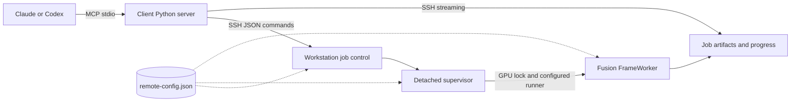

# Architecture

VisoMaster MCP splits the work between two machines. The client runs a small MCP server with no
GPU code. The workstation runs job control and the Fusion adapter. This page explains how the
pieces fit, why they are split this way, and which guarantees each part provides.

## Overview

The client process implements MCP with the official Python SDK over stdio. Every control
operation starts a short SSH command on the workstation. A request that does real work creates
a durable job directory and detaches a supervisor. Because the job lives on the workstation,
any client can reconnect later to query or cancel it.

Three processes take part in a GPU job:

- **Control commands** (`control.py`) are short-lived. They validate requests, publish job
  directories, answer status queries and stream files.
- **The supervisor** runs with the workstation's system Python. It waits for the GPU, starts the
  worker, enforces cancellation and publishes the job's terminal state.
- **The worker** (`engine.py`) runs through the configured runner in Fusion's environment, with
  `CUDA_DEVICE_ORDER=PCI_BUS_ID`, `CUDA_VISIBLE_DEVICES` set to the configured GPU index,
  offscreen Qt and two CPU threads.

A separate worker process per job releases model memory when the job ends and contains
failures in native libraries.

`common.py` and `control.py` use only the standard library, so they run with the workstation's
system Python. Only the worker imports Fusion.

## Configuration

Configuration is split by what it describes.

**Client settings say where to connect.** `VISOMASTER_HOST`, `VISOMASTER_REMOTE` and the
optional interpreter, SSH program and download directory come from the client registration.
`transport.py` validates them on the first tool call. It builds the SSH argv with `--` before
the host and quotes the remote command with `shlex.join`. `deploy.sh` runs the same validation
before any SSH call.

**Workstation settings say where things are.** They live in one file, `remote-config.json` in
the deployment root, and nothing is forwarded over SSH. Control commands, supervisors and
workers each find the file relative to their own resolved code path, two levels above a release
directory. Every client and every reconnect therefore sees the same values.

Loading the configuration never fails at import. A missing or invalid file is reported by
`health` and refuses every other action.

### Pinning the configuration to a job

Each job stores the SHA-256 of the effective, resolved configuration. The release pins the code,
and this identity pins the configuration:

1. `submit` starts the supervisor with the absolute job directory and the identity, so the
   supervisor never looks the job up through configuration that may have changed.
2. After taking the job's lease, the supervisor reloads the configuration. It fails the job, in
   its original directory, if the file is invalid, the identity differs or the state directory
   moved.
3. It repeats the check while waiting for the GPU lock and once more before starting the worker.
4. The worker receives `VM_CONFIG` and `VM_CONFIG_SHA256` and checks the identity again before
   importing Fusion.

## Releases

Each deployment publishes the three workstation files as a new, immutable release directory.
The `remote` symlink selects one.

A control command started through the `remote` symlink re-executes from the release directory
the link resolves to, before it loads any project module. The command, its supervisor and its
engine therefore all come from one release.

Submission rechecks the selected release after taking the submit lock. If a deployment switched
it meanwhile, the command reruns from the new release with the same request. Each job records
its release.

`deploy.sh` uploads a candidate under a unique name and preflights it. It then runs the
candidate's `promote` action, which:

1. takes the submit lock;
2. refuses while jobs are queued or running, unless forced;
3. replaces the link through a uniquely named staging link;
4. verifies that the link selects the candidate;
5. removes all but the five newest releases.

Promotion never removes the selected release or one that an active job records, and removes
none while an active job lacks that record. As a result, a deployment either sees a job, or the
job runs the release it selected. Concurrent deployments cannot promote each other's candidate.
A legacy flat `remote` directory is moved into `releases/` before the first switch.

## The Fusion revision guard

The adapter imports Fusion's own processing classes, so it is tied to one Fusion commit,
`REVISION` in `remote/common.py`. GPU jobs refuse to run when the checkout is at another commit,
or has tracked local changes under `app/`, staged or not. Untracked files and other directories
are not checked.

`health_check` runs the same standard-library check. It reports `compatible: false` with the
reason in `compatibility_reason`. Normalization does not use Fusion and is unaffected.

Fusion's internals change between commits, and the adapter calls them directly. Running against
an unqualified revision could fail in confusing ways or, worse, produce subtly different output.
Moving to a new revision therefore requires inspection and fresh GPU evidence; see
[Qualify a new Fusion revision](../how-to/test-and-qualify.md#qualify-a-new-fusion-revision).

## The runner

The runner must `exec` Fusion's interpreter. The worker checks that its parent is the
supervisor, and reports a runner that forks instead with an actionable error. This matters
because cancellation and crash cleanup work on the worker's process group, which the supervisor
creates.

## Job control

### Atomic state and idempotent submission

State and progress files are written by atomic replacement, so a reader never sees a partial
file.

Submission holds a shared lock. Under it, an existing job ID is answered from its persisted
request, compared as canonical JSON, before any input or Fusion file is consulted. An exact retry
therefore returns the job even after its inputs are gone, and a changed payload is a conflict.
Only a new job is validated and published.

### The GPU lock

A per-GPU lock, `gpu-<index>.lock` in the configured lock directory, serializes workers across
clients and across deployments that share that directory. The worker inherits the lock and
holds it until it exits. The order in which waiting jobs take the lock is decided by a queue;
see [GPU scheduling](gpu-scheduling.md).

### Process groups and cancellation

The supervisor first starts a small guard process that leads a new process group, then starts
the worker in that group. It reaps the guard last, so the group ID stays reserved and signals to
it cannot reach another group. The supervisor records the group ID and a random token in
`group.json`, and puts the token in the worker's environment.

Cancellation checks the job and writes its marker under the submit lock, so a delayed request
cannot mark a replacement job that reused the ID. Then:

1. The supervisor sends SIGTERM to the group and gives the worker 10 seconds to exit.
2. However the worker exits, the supervisor kills the remaining group members and waits for
   them.
3. Only then does it publish a terminal state.

A cancellation that arrives after the worker has succeeded leaves the job completed.

### Crash recovery

- If the supervisor dies, the guard sees its pipe close and kills the group. Linux parent-death
  handling also stops the worker.
- If the guard dies, the supervisor sees its output close and fails the job. It kills the group
  while the unreaped guard still reserves its ID.
- On status access, a job whose supervisor lease vanished becomes failed: after a startup grace
  period, or at once if it had recorded its group.
- On Linux, that reconciliation first kills any recorded group members that survived the guard
  and the supervisor. It signals only processes in the recorded group whose environment carries
  the token, rechecked through a pidfd, so a reused group or process ID is never signalled.
  macOS lacks `/proc` and pidfds, so there the guard alone stops the group.

Terminal states record `finished_at`. Older terminal records without it report their state
file's modification time, which status, listing and pruning share.

## Security boundaries

### Input paths

Media paths are resolved first, so symlinks and `..` are judged by their targets. The result
must lie within the configured media root, or be a managed state file: a complete upload in
`uploads/` or a file under a completed job's `artifacts/`.

Artifacts of a queued or running job may still be written, and those of a failed or cancelled
job may be partial, so submission and inspection refuse them with the job's status. The check
still holds when a queued consumer's worker revalidates: a completed state is never rewritten,
and retention refuses to delete, and so to replace under the same ID, a job whose artifacts a
queued or running job uses.

The rest of the state tree (requests, logs, locks, staging, trash, partial uploads) is never an
input, whether or not it lies inside the media root. Artifact paths resolve inside their job
directory.

### Containers

Every FFmpeg and FFprobe input, including timing probes, normalization and the render's audio
input, is opened with only the `file` protocol and a demuxer allowlist of self-contained
formats: MP4/MOV, Matroska/WebM, AVI, MPEG-TS, and single PNG, JPEG, WebP or BMP images.

Libavformat refuses any other detected format before reading its header. An HLS playlist or a
concat list, whatever its extension, therefore cannot open files that the path check never saw;
the probe reports it as an unsupported container. FFprobe reads JPEGs detected as `image2` with
pattern expansion off, and the FFmpeg CLI never uses `image2`, so `%d` names do not expand into
other files.

### Transport

SSH provides transport and authentication. MCP adds no listening TCP endpoint.

### Uploads

Uploads are named by the SHA-256 the client computes before sending. An existing file with that
name and size is returned without a transfer. New files are published only after a complete
transfer whose size and hash the workstation verifies. Older random 32-hex names remain
accepted.

### Artifact transfers

An artifact transfer is one workstation command. It opens the completed job's directory and the
artifact without following symlinks, then sends a size header and exactly those bytes from the
same descriptor. A job deleted and replaced under the same ID mid-transfer cannot substitute its
content.

Video transfers stream to disk. Inline PNG and JPEG responses have a 10 MB limit, which the
workstation checks before sending and the client enforces while reading.

A download streams into a temporary file in the downloads root, then is renamed into the job's
subdirectory, which is reopened without following symlinks. A symlinked or swapped job directory
cannot redirect the write outside the root.

Uploads and artifact downloads are foreground MCP calls, so very large transfers depend on the
client's timeout configuration. Long rendering work is always submitted as a background job.

## Retention

Retention decisions share the submit lock.

Submission validates inputs under the lock and stores `resolved.json` beside the unchanged
`request.json`: the request with every media, target and source path resolved. The worker opens
those resolved paths, so redirecting an alias later changes neither what a job reads nor what
cleanup protects.

Deletion and pruning, including the dry run, apply one eligibility check under the lock:

- the job's supervisor lease must be free;
- its state must be terminal;
- for pruning, its finish time must be older than the cutoff;
- no queued or running job's resolved input, no input of a resumable render and no input a saved
  recipe revision names may lie inside it.

The check reads the job generation that it then renames to a trash name, and the trash is
removed outside the lock.

An upload file or directory is kept when a resolved input is that path or lies beneath it,
compared by path component. While any active job lacks `resolved.json` (submitted by an earlier
release), its inputs are unknown and no job or upload is removed.

Upload reuse refreshes the file's timestamp, and upload publication renames the completed file,
under the same lock. A prune either sees the refresh or the new file, or removes the old file
first and the reuse becomes a cache miss. Streaming stays outside the lock.

## Scope

The first release covers conventional flat images and constant-frame-rate videos,
embedding-based swap models, selected mask controls, face restoration and expression
restoration. GUI workspace import, DFM, AlphaFace, VR180, timeline markers and manual face
editing would need additional adapters and qualification.

## Related pages

- [GPU scheduling](gpu-scheduling.md)
- [Face matching](face-matching.md)
- [Video processing](video-processing.md)
- [Recipes, preflight and qualification](reproducibility.md)
- [Configuration reference](../reference/configuration.md)
